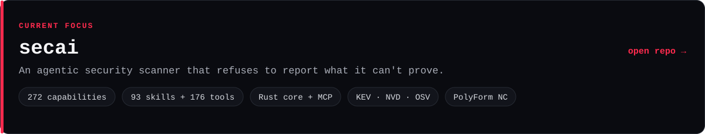
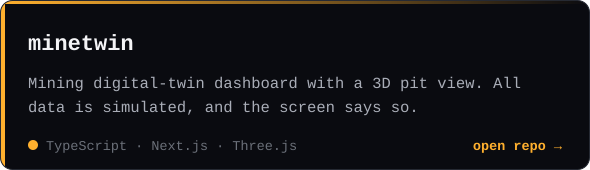
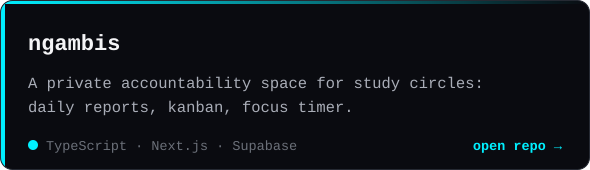
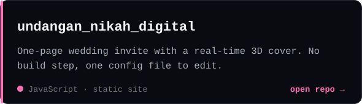
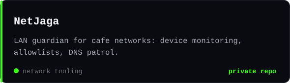
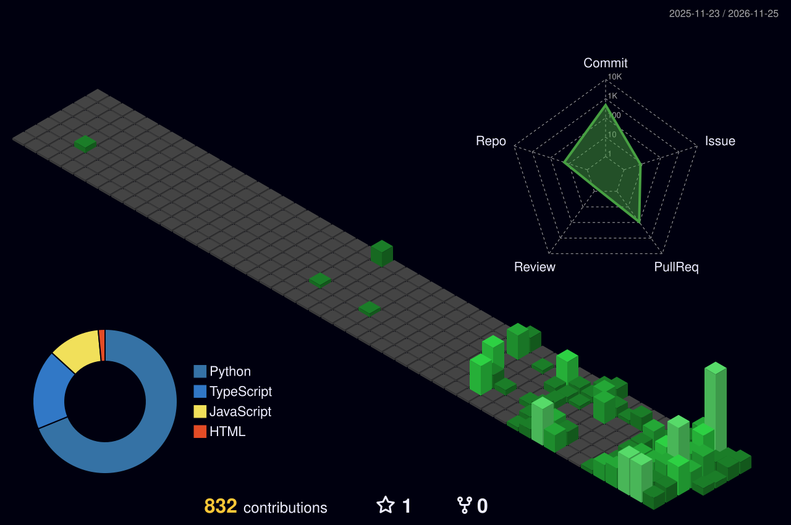

  
  
  
  

### Self-scan

**This profile scans itself.** Every night a GitHub Action pulls these numbers
straight from the API — detections merged upstream, their severity mix, the
latest CVE shipped, secai's CI state — and redraws the board above. Same rule
as secai: the figures are real, or the run fails and nothing changes. The
generator is right here in the repo: [`.github/scripts/selfscan.py`](.github/scripts/selfscan.py).

### About

Detection engineering, mostly — the unglamorous half of security where a
finding only counts if you can prove it. I'd rather ship a short report
that survives triage than a long one that gets bounced with *"impact not
demonstrated."*

Most of my time goes to **secai**, an agentic scanner built on a single
rule: a finding you can't prove is a lead, not a claim. Every result sits
on an explicit evidence ladder, and nothing reaches the report until
independent sources agree on it.

The rest of the week splits between network tooling for small businesses
(café Wi‑Fi is a jungle), scrapers that keep working when the site fights
back, and patches sent upstream to the tools I rely on.

### Projects

<b>Open source contributions</b> ·  · 

 

PRs sent to tools I actually use — vuln templates, scrapers, wordlists,
advisories. The status column is live, so this table can't quietly lie.
Showing the highlights; the full list lives in [CONTRIBUTIONS.md](CONTRIBUTIONS.md).

| Project | PR | Status |
|---|---|---|
| [nuclei-templates](https://github.com/projectdiscovery/nuclei-templates) | [#17653](https://github.com/projectdiscovery/nuclei-templates/pull/17653) · stop `dell-idrac9-detect` matching Apple AirPlay receivers |  |
| [Scrapling](https://github.com/D4Vinci/Scrapling) | [#515](https://github.com/D4Vinci/Scrapling/pull/515) · fix a flaky Cloudflare readiness test on macOS / 3.10 |  |
| [nuclei-templates](https://github.com/projectdiscovery/nuclei-templates) | [#17669](https://github.com/projectdiscovery/nuclei-templates/pull/17669) · CVE-2026-119495 · Better Search: unauthenticated arbitrary post-type disclosure |  |
| [nuclei-templates](https://github.com/projectdiscovery/nuclei-templates) | [#17672](https://github.com/projectdiscovery/nuclei-templates/pull/17672) · CVE-2026-120597 · Welcart e-Commerce: unauthenticated reflected XSS |  |
| [nuclei-templates](https://github.com/projectdiscovery/nuclei-templates) | [#17675](https://github.com/projectdiscovery/nuclei-templates/pull/17675) · CVE-2026-120446 · madong-admin-saas: platform tenant disclosure |  |
| [nuclei-templates](https://github.com/projectdiscovery/nuclei-templates) | [#17676](https://github.com/projectdiscovery/nuclei-templates/pull/17676) · CVE-2026-120442 · ape-volo-admin: auth bypass via hardcoded JWT secret |  |
| [nuclei-templates](https://github.com/projectdiscovery/nuclei-templates) | [#17685](https://github.com/projectdiscovery/nuclei-templates/pull/17685) · CVE-2026-118523 · EventPrime: unauthenticated pending-post disclosure |  |
| [nuclei-templates](https://github.com/projectdiscovery/nuclei-templates) | [#17691](https://github.com/projectdiscovery/nuclei-templates/pull/17691) · CVE-2026-115574 · Zulip Server: custom profile field disclosure |  |

<a href="CONTRIBUTIONS.md"><b>See every PR, grouped by project →</b></a>

<b>Earlier research</b> · computer vision on dental imaging

 

Before security I worked on medical imaging. That's where I learned to
distrust any metric I can't reproduce.

- [Mandible segmentation with U‑Net](https://github.com/maulanawirawan/Mandible-Segmentation-with-UNET) (PyTorch)
- [FPN with an EfficientNet‑B7 backbone](https://github.com/maulanawirawan/FPN-with-EFFICIENTNET-B7-backbone-for-Segmentation-Task) (PyTorch)
- [Periodontal disease classification with a CNN](https://github.com/maulanawirawan/Periodontal-Diseases-with-CNN) (TensorFlow / Keras)

<b>Stack</b>

 

<b>Activity</b> · 3D contribution graph

 

<picture>
  <source media="(prefers-color-scheme: dark)" srcset="https://raw.githubusercontent.com/maulanawirawan/maulanawirawan/output/github-contribution-grid-snake-dark.svg"/>
  <source media="(prefers-color-scheme: light)" srcset="https://raw.githubusercontent.com/maulanawirawan/maulanawirawan/output/github-contribution-grid-snake.svg"/>
  
</picture>

### Capture the flag

Three flags are hidden in the SVGs on this page: the board that scans me, the
evidence ladder, and the terminal's house rules. Each one is wrapped in a
different classic encoding (base64, hex, rot13). Find all three, then prove it
without leaking them: post `sha256("your-username:flag")` for each in a
**CTF submission** issue. A bot checks the proofs and signs you into the
[Hall of Fame](HALL-OF-FAME.md). Rules: [CTF.md](CTF.md).

Never post a raw flag. Authorized target: this profile. `view-source` is the whole toolkit.

### Get in touch

Open to detection engineering, network security tooling, and scraping
work — collab or hire. Fastest way to reach me is an issue or PR on
[secai](https://github.com/maulanawirawan/secai/issues). I read every one.
