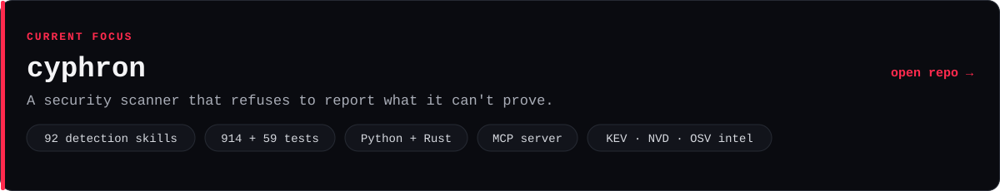
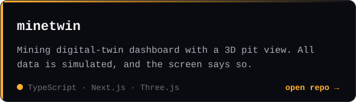
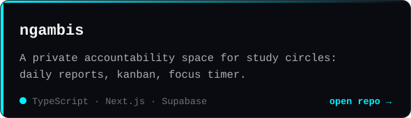
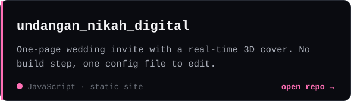
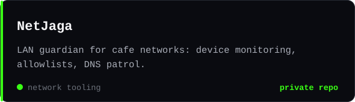
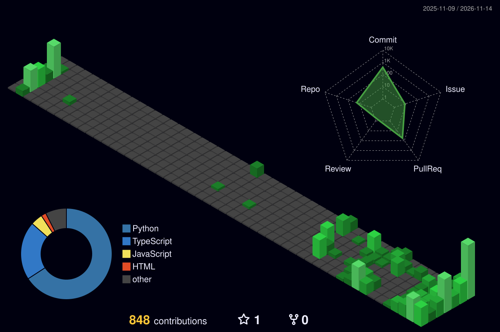

  
  
  

### About

I work on the boring-but-important side of security: detection,
evidence, and tooling that doesn't cry wolf. Most of my time goes into
cyphron, a scanner built around one rule. If a finding can't be proven,
it doesn't go in the report.

Outside of that I build network tools for small businesses (cafe Wi‑Fi
is a jungle), write scrapers that keep working when the site fights
back, and send fixes upstream to the open-source tools I use.

### Projects

<b>Open source contributions</b> · 8 merged upstream · 25 open

 

PRs I've sent to projects I depend on. The status column is live.

| Project | PR | Status |
|---|---|---|
| [nuclei-templates](https://github.com/projectdiscovery/nuclei-templates) | [#17653](https://github.com/projectdiscovery/nuclei-templates/pull/17653) · stop `dell-idrac9-detect` matching Apple AirPlay receivers |  |
| [Scrapling](https://github.com/D4Vinci/Scrapling) | [#515](https://github.com/D4Vinci/Scrapling/pull/515) · fix a flaky Cloudflare readiness test on macOS / 3.10 |  |
| [nuclei-templates](https://github.com/projectdiscovery/nuclei-templates) | [#17669](https://github.com/projectdiscovery/nuclei-templates/pull/17669) · CVE-2026-119495 · Better Search: unauthenticated arbitrary post-type disclosure |  |
| [nuclei-templates](https://github.com/projectdiscovery/nuclei-templates) | [#17672](https://github.com/projectdiscovery/nuclei-templates/pull/17672) · CVE-2026-120597 · Welcart e-Commerce: unauthenticated reflected XSS |  |
| [nuclei-templates](https://github.com/projectdiscovery/nuclei-templates) | [#17675](https://github.com/projectdiscovery/nuclei-templates/pull/17675) · CVE-2026-120446 · madong-admin-saas: platform tenant disclosure |  |
| [nuclei-templates](https://github.com/projectdiscovery/nuclei-templates) | [#17676](https://github.com/projectdiscovery/nuclei-templates/pull/17676) · CVE-2026-120442 · ape-volo-admin: auth bypass via hardcoded JWT secret |  |
| [nuclei-templates](https://github.com/projectdiscovery/nuclei-templates) | [#17685](https://github.com/projectdiscovery/nuclei-templates/pull/17685) · CVE-2026-118523 · EventPrime: unauthenticated pending-post disclosure |  |
| [nuclei-templates](https://github.com/projectdiscovery/nuclei-templates) | [#17691](https://github.com/projectdiscovery/nuclei-templates/pull/17691) · CVE-2026-115574 · Zulip Server: custom profile field disclosure |  |
| [nuclei-templates](https://github.com/projectdiscovery/nuclei-templates) | [#17720](https://github.com/projectdiscovery/nuclei-templates/pull/17720) · CVE-2026-62850 · FreeScout maintenance-endpoint path disclosure |  |
| [nuclei-templates](https://github.com/projectdiscovery/nuclei-templates) | [#17719](https://github.com/projectdiscovery/nuclei-templates/pull/17719) · CVE-2026-123655 · Moodle H5P content file listing |  |
| [nuclei-templates](https://github.com/projectdiscovery/nuclei-templates) | [#17704](https://github.com/projectdiscovery/nuclei-templates/pull/17704) · CVE-2026-12122 · Kirki: symbol metadata disclosure |  |
| [nuclei-templates](https://github.com/projectdiscovery/nuclei-templates) | [#17703](https://github.com/projectdiscovery/nuclei-templates/pull/17703) · CVE-2026-120846 · Uncanny Automator: recipe disclosure |  |
| [nuclei-templates](https://github.com/projectdiscovery/nuclei-templates) | [#17686](https://github.com/projectdiscovery/nuclei-templates/pull/17686) · CVE-2026-118754 · Dolibarr: draft job-position disclosure |  |
| [nuclei-templates](https://github.com/projectdiscovery/nuclei-templates) | [#17682](https://github.com/projectdiscovery/nuclei-templates/pull/17682) · CVE-2026-112244 · Duplicator: full path disclosure |  |
| [nuclei-templates](https://github.com/projectdiscovery/nuclei-templates) | [#17673](https://github.com/projectdiscovery/nuclei-templates/pull/17673) · CVE-2026-119485 · Dokan: vendor-only product disclosure |  |
| [nuclei-templates](https://github.com/projectdiscovery/nuclei-templates) | [#17670](https://github.com/projectdiscovery/nuclei-templates/pull/17670) · CVE-2026-39743 · WCFM Membership: selection disclosure |  |
| [nuclei-templates](https://github.com/projectdiscovery/nuclei-templates) | [#17667](https://github.com/projectdiscovery/nuclei-templates/pull/17667) · FP fix · WSUS: verify SoapFormatter types before matching |  |
| [nuclei-templates](https://github.com/projectdiscovery/nuclei-templates) | [#17651](https://github.com/projectdiscovery/nuclei-templates/pull/17651) · CVE-2026-96654 · Plex Media Server detection (KEV) |  |
| [nuclei-templates](https://github.com/projectdiscovery/nuclei-templates) | [#17654](https://github.com/projectdiscovery/nuclei-templates/pull/17654) · fewer false positives in `smb-default-login` via a canary credential |  |
| [nuclei-templates](https://github.com/projectdiscovery/nuclei-templates) | [#17727](https://github.com/projectdiscovery/nuclei-templates/pull/17727) · CVE-2026-102657 · esm.sh web handler: unauthenticated path traversal |  |
| [nuclei-templates](https://github.com/projectdiscovery/nuclei-templates) | [#17722](https://github.com/projectdiscovery/nuclei-templates/pull/17722) · CVE-2026-124027 · ChatWiki: unauthenticated cross-tenant document disclosure |  |
| [nuclei-templates](https://github.com/projectdiscovery/nuclei-templates) | [#17742](https://github.com/projectdiscovery/nuclei-templates/pull/17742) · CVE-2026-122060 · WP Recipe Maker: unauthenticated password-protected recipe disclosure |  |
| [nuclei-templates](https://github.com/projectdiscovery/nuclei-templates) | [#17743](https://github.com/projectdiscovery/nuclei-templates/pull/17743) · CVE-2026-120409 · All-in-One Video Gallery: unauthenticated password-protected video source disclosure |  |
| [nuclei-templates](https://github.com/projectdiscovery/nuclei-templates) | [#17748](https://github.com/projectdiscovery/nuclei-templates/pull/17748) · CVE-2026-125357 · Munin munin-httpd: unauthenticated path traversal to munin.conf |  |
| [nuclei-templates](https://github.com/projectdiscovery/nuclei-templates) | [#17721](https://github.com/projectdiscovery/nuclei-templates/pull/17721) · CVE-2026-102359 · Kroki TikZ backend: unauthenticated local file read |  |
| [advisory-database](https://github.com/github/advisory-database) | [#10933](https://github.com/github/advisory-database/pull/10933) · Craft CMS SQLi: add upstream repo + fixed-release references |  |
| [advisory-database](https://github.com/github/advisory-database) | [#10932](https://github.com/github/advisory-database/pull/10932) · Craft CMS priv-esc: add upstream repo + fixed-release references |  |
| [advisory-database](https://github.com/github/advisory-database) | [#10908](https://github.com/github/advisory-database/pull/10908) · Mnestix: add upstream repo + fixed-release references |  |
| [advisory-database](https://github.com/github/advisory-database) | [#10923](https://github.com/github/advisory-database/pull/10923) · BTCPay Server: add upstream repo + fixed-release references |  |
| [advisory-database](https://github.com/github/advisory-database) | [#10929](https://github.com/github/advisory-database/pull/10929) · Parse Server: add upstream repo + fixed-release references |  |
| [PayloadsAllTheThings](https://github.com/swisskyrepo/PayloadsAllTheThings) | [#871](https://github.com/swisskyrepo/PayloadsAllTheThings/pull/871) · podman alternative for local markdownlint validation |  |
| [OWASP CheatSheetSeries](https://github.com/OWASP/CheatSheetSeries) | [#2911](https://github.com/OWASP/CheatSheetSeries/pull/2911) · deduplicate OS command content (Injection Prevention) |  |
| [SecLists](https://github.com/danielmiessler/SecLists) | [#1353](https://github.com/danielmiessler/SecLists/pull/1353) · Travis CI `[secure]` env variable wordlist (1,400 names) |  |
| [Scrapling](https://github.com/D4Vinci/Scrapling) | [#513](https://github.com/D4Vinci/Scrapling/pull/513) · bound async `all_headers()` waits so they can't hang forever |  |

<b>Earlier research</b> · computer vision on dental imaging

 

Before security I worked on medical imaging. That's where I learned to
distrust any metric I can't reproduce.

- [Mandible segmentation with U‑Net](https://github.com/maulanawirawan/Mandible-Segmentation-with-UNET) (PyTorch)
- [FPN with an EfficientNet‑B7 backbone](https://github.com/maulanawirawan/FPN-with-EFFICIENTNET-B7-backbone-for-Segmentation-Task) (PyTorch)
- [Periodontal disease classification with a CNN](https://github.com/maulanawirawan/Periodontal-Diseases-with-CNN) (TensorFlow / Keras)

<b>Stack</b>

 

<b>Activity</b> · 3D contribution graph

 

<picture>
  <source media="(prefers-color-scheme: dark)" srcset="https://raw.githubusercontent.com/maulanawirawan/maulanawirawan/output/github-contribution-grid-snake-dark.svg"/>
  <source media="(prefers-color-scheme: light)" srcset="https://raw.githubusercontent.com/maulanawirawan/maulanawirawan/output/github-contribution-grid-snake.svg"/>
  
</picture>

### Get in touch

Happy to collaborate on detection engineering, network security tooling,
or scraping pipelines. The easiest way to reach me is an issue on
[cyphron](https://github.com/maulanawirawan/cyphron/issues), or just open
a PR. I read them all.
