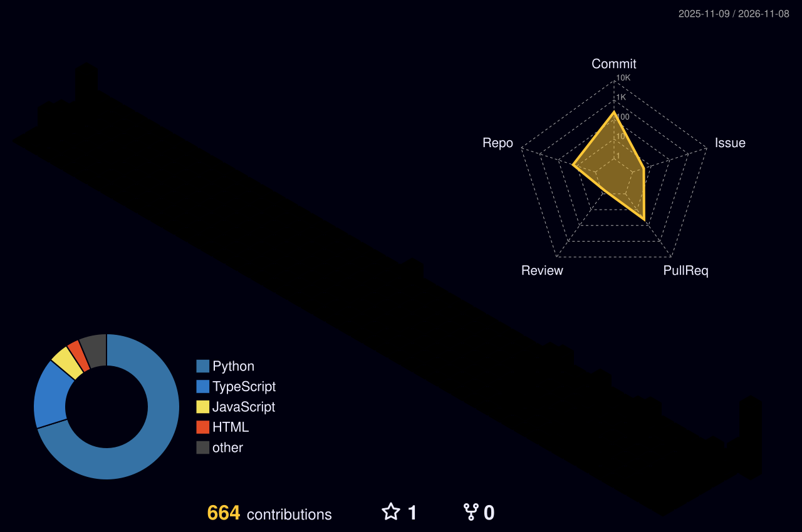

<div align="center">


<br/>

<a href="https://github.com/maulanawirawan/cyphron"></a>


</div>

## `01` ▸ WHOAMI


I work on the boring-but-important side of security: detection,
evidence, and tooling that doesn't cry wolf.

Most of my time goes into **[cyphron](https://github.com/maulanawirawan/cyphron)**.
It's a security assessment engine built around one rule: if a finding
can't be proven, it doesn't go in the report. Outside of that I build
network tools for small businesses (cafe Wi‑Fi is a jungle), write
scrapers that keep working when the site fights back, and send fixes
upstream to the open-source tools I use every day.

Before security I did computer vision on dental imaging (U‑Net, FPN, CNN
classifiers). That's where I learned to distrust any metric I can't
reproduce.

## `02` ▸ PRIMARY TARGET

> [!IMPORTANT]
> **[cyphron](https://github.com/maulanawirawan/cyphron)** · Python + Rust
>
> An evidence-first security assessment engine. It has 92 detection skills,
> one strict `findings.json` contract shared by Python and Rust, and a
> cross-tool quorum that only promotes a lead when independent sources
> agree. Threat intel refreshes itself from CISA KEV, NVD, and OSV.
> 914 Python + 59 Rust tests run in CI, and it ships with an MCP server so
> you can drive it from Claude Code or Cursor.
>
> *No exploit, no report.*

## `03` ▸ UPSTREAM OPS

These are PRs I've sent to projects I depend on. The status column is
live, so it shows what's really there.

| Target | Op | Status |
|---|---|---|
| [nuclei-templates](https://github.com/projectdiscovery/nuclei-templates) | [#17651](https://github.com/projectdiscovery/nuclei-templates/pull/17651) · CVE-2026-96654 Plex Media Server detection (KEV) |  |
| [nuclei-templates](https://github.com/projectdiscovery/nuclei-templates) | [#17654](https://github.com/projectdiscovery/nuclei-templates/pull/17654) · fewer false positives in `smb-default-login` via a canary credential |  |
| [nuclei-templates](https://github.com/projectdiscovery/nuclei-templates) | [#17653](https://github.com/projectdiscovery/nuclei-templates/pull/17653) · stop `dell-idrac9-detect` matching Apple AirPlay receivers |  |
| [Scrapling](https://github.com/D4Vinci/Scrapling) | [#513](https://github.com/D4Vinci/Scrapling/pull/513) · bound async `all_headers()` waits so they can't hang forever |  |
| [Scrapling](https://github.com/D4Vinci/Scrapling) | [#515](https://github.com/D4Vinci/Scrapling/pull/515) · fix a flaky Cloudflare readiness test on macOS / 3.10 |  |

## `04` ▸ SIDE MISSIONS

| | Project | What it is |
|---|---|---|
| ⛏️ | [minetwin](https://github.com/maulanawirawan/minetwin) | A mining digital-twin dashboard with a 3D pit view. All data is simulated, and the screen says so. |
| 📚 | [ngambis](https://github.com/maulanawirawan/ngambis) | A private accountability space for study circles: daily reports, kanban, focus timer. |
| 💍 | [undangan_nikah_digital](https://github.com/maulanawirawan/undangan_nikah_digital) | A one-page wedding invite with a real-time 3D cover. No build step, one config file. |
| 🛡️ | NetJaga *(private)* | A LAN guardian for cafe networks: device monitoring, allowlists, DNS patrol. |
| 🦷 | [U‑Net](https://github.com/maulanawirawan/Mandible-Segmentation-with-UNET) · [FPN](https://github.com/maulanawirawan/FPN-with-EFFICIENTNET-B7-backbone-for-Segmentation-Task) · [CNN](https://github.com/maulanawirawan/Periodontal-Diseases-with-CNN) | Dental imaging research: mandible segmentation and periodontal disease classification. |

## `05` ▸ ARSENAL

<p>
  
</p>

## `06` ▸ ACTIVITY TRACE



<picture>
  <source media="(prefers-color-scheme: dark)" srcset="https://raw.githubusercontent.com/maulanawirawan/maulanawirawan/output/github-contribution-grid-snake-dark.svg"/>
  <source media="(prefers-color-scheme: light)" srcset="https://raw.githubusercontent.com/maulanawirawan/maulanawirawan/output/github-contribution-grid-snake.svg"/>
  
</picture>

## `07` ▸ OPEN CHANNEL

I'm happy to collaborate on detection engineering, network security
tooling, or scraping pipelines. The easiest way to reach me is an issue
on [cyphron](https://github.com/maulanawirawan/cyphron/issues), or just
open a PR. I read them all.

<div align="center">

```
// end of transmission · fueled by too much kopi ☕
```

</div>
